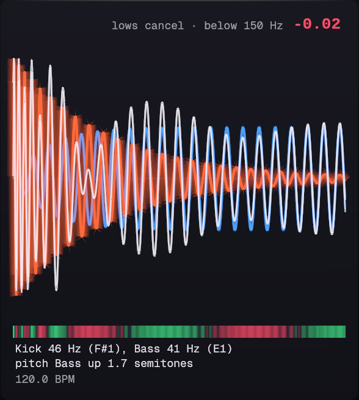
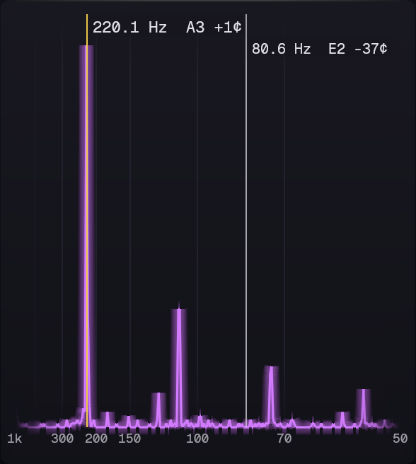
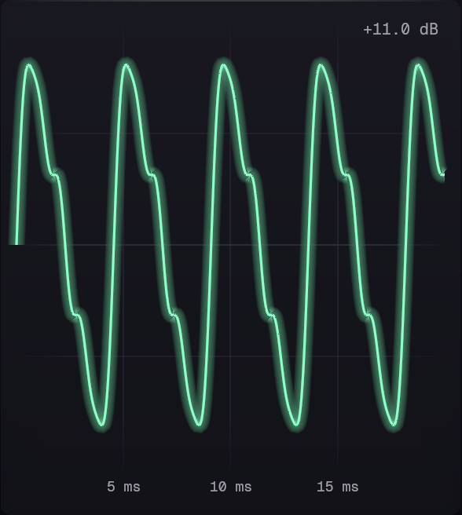
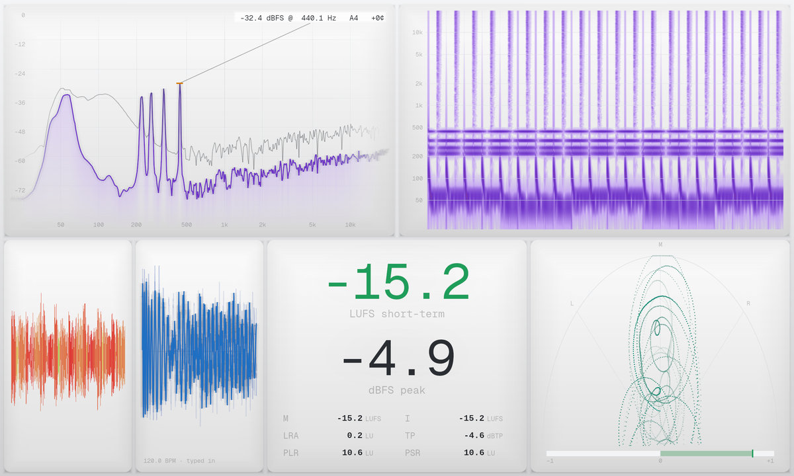
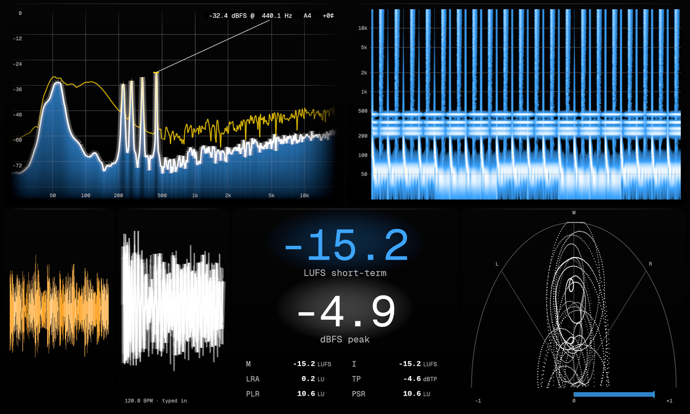

# Das-Meter

**Live audio Meters for producers: eight Meters, two Looks, any colour you
like.** Das-Meter shows whatever your computer plays, or single tracks from
your DAW, as Waveform, Spectrum, Spectrogram, Loudness, Stereometer, Phase
Scope, Cepstrum and Oscilloscope. Put them in a Bar along the edge of your
screen or in a window of their own, and make them look the way you want.
It's free and open source, for macOS and Linux, with Windows on the way.


**[Download](https://github.com/daswerk/Das-Meter/releases/latest)** ·
**[Install guide](INSTALL.md)** ·
**[Docs](https://daswerk.github.io/Das-Meter/)**

## Two Looks

Every Theme is drawn in one of two **Looks**, and switching is one click in
**Settings ▸ Theme**.

- **Smooth** (the default): floating rounded panels on a soft gradient,
  grids that fade out toward the edges, a soft glow under the traces, fills
  that fade to transparent, and Meters that dim gently in silence.
- **Classic**: the flat, plain look of earlier versions, pixel for pixel.


## The Meters

| Meter | What it shows |
|---|---|
| **Waveform** | The audio over time, coloured by low, mid and high band; mono, Left/Right or Mid/Side; 1–30 s. |
| **Spectrum** | How loud each frequency is, as a line or bars, with a slope, peak hold and a peak line that names the loudest note. Drag a box to **zoom** into it at a finer resolution. |
| **Spectrogram** | The Spectrum over time, scrolling, with the same zoom. |
| **Loudness Meter** | Momentary, short-term and integrated LUFS, LRA, true peak, PLR and PSR, as big numbers, bars or a loudness graph, with a target line. It measures to ITU-R BS.1770-5 and EBU Tech 3341/3342, checked against the EBU test set ([what that means](https://daswerk.github.io/Das-Meter/measurements.html)). |
| **Stereometer** | Where the sound sits between left and right, with the phase correlation and an optional balance bar. |
| **Phase Scope** | One beat or bar held still, so a kick on the beat stays put. It follows your DAW's tempo, or a typed or tapped one. Overlay a second track (say, the bass under the kick) to see where their lows cancel, with the **Cycle correlation** and suggestions to fix it (flip, move or retune). |
| **Cepstrum** | The pitch of a voice or instrument, with its note: handy for tuning. |
| **Oscilloscope** | The wave itself over 1–200 ms, held still on a steady tone. |

<table>
<tr>
<td></td>
<td></td>
<td></td>
</tr>
<tr>
<td align="center">Phase Scope with an Overlay Source</td>
<td align="center">Cepstrum</td>
<td align="center">Oscilloscope</td>
</tr>
</table>


## Make it yours

**Full Theme customization.** A Theme sets every colour, by role, for every
Meter and the app around it, plus the styling:

- **Look**: Smooth or Classic, and for Smooth the **Glow**, **Grid fade**,
  **Gradient** and **Vignette**, and whether Meters **dim when silent**.
- **Layout**: background opacity (down to see-through), line thickness, gaps
  between Meters, corner radius and text size.
- **Colours**: background, panels, grid, text and accent, and each Meter's own
  colours (Waveform bands, Spectrum line and fill, peak dots and harmonics,
  loudness, correlation and Phase Scope colours, and more), with a live
  preview.
- A single Meter can override any colour of its Theme.

It comes with **Nocturne** (the default), **Dark**, **Light**, **High
contrast** (colour-blind-safe, with shape cues besides colour), **Midnight
Purple**, **Deep Turquoise** and **Graphite**. A Preset can follow the system's
light/dark setting with a pair of Themes. Change anything in a built-in and
it's saved as your own copy, which you can rename. Themes are plain TOML files
in the themes folder, so you can share them.


<table>
<tr>
<td></td>
<td></td>
</tr>
<tr>
<td align="center">Light</td>
<td align="center">High contrast</td>
</tr>
</table>

**Every Meter has its settings** in its right-click menu and in the settings
window: channels, FFT size, ranges, ballistics, targets and more.

## Layouts

- **Bar**: a strip of Meters docked to a screen edge, as many as you like of
  any kind. Resize it, share out its space, or ⌘-drag it anywhere. On Windows
  it can reserve its space so other windows make room; it can float on top and
  stay over fullscreen apps.
- **Pop-outs**: pull any Meter out of the Bar into its own window, and dock it
  back.
- **Window mode**: all Meters in one window, split into resizable panes.
- **Multiple displays**: each window remembers its display and comes back to
  it.


## Presets

A **Preset** saves which Meters you see, how they're arranged, their settings
and their Theme. Changes save on their own, and **Revert Preset** undoes them.
Switch with ⌘1–⌘9. Built-ins for **Bar**, **Mixing**, **Mastering**,
**Mastering advanced**, **Producing** and **Compact** get you started.
**Export Preset…** writes one `.dasmeter-preset` file with its Theme inside,
for someone else to import.

## Where the audio comes from

- **System Capture** (the default): everything your computer plays, with no
  driver to install.
- **Send Plugins**: put the Das-Meter Send Plugin (CLAP, VST3 and AU) on DAW
  tracks, and each Meter picks which track it shows. They work behind ASIO
  too, and tell the Phase Scope the DAW's tempo and beat. Each one is named
  after its track and takes the track's colour.

Das-Meter is light on your computer: it draws only when something changes,
sleeps in silence, and does its analysis outside your DAW.

## Install

| | |
|---|---|
| **macOS** 14.6+, Apple silicon and Intel | Download `Das-Meter-<version>.dmg`, drag Das-Meter to Applications, then allow it once under **System Settings ▸ Privacy & Security ▸ Open Anyway**. |
| **Linux** x86_64 (Arch, Fedora, Ubuntu 24.04+…), PipeWire | Download `das-meter-<version>-linux-x86_64.tar.gz`, unpack it and run `./das-meter`. There's no Send Plugin for Linux yet. |
| **Windows** 10 and 11 | Coming soon. |

The [install guide](INSTALL.md) has every step, including the Send Plugin,
updates, uninstalling and building from source. The
[docs](https://daswerk.github.io/Das-Meter/) explain every Meter and setting.

## Building from source

You need a recent stable [Rust](https://rustup.rs) (1.95 or newer). On Linux
you also need a few system libraries; see
[Building from source](INSTALL.md#building-from-source).

```sh
cargo run --release --bin das-meter   # run the app
cargo test --workspace                # run the tests
```

On macOS, `scripts/macos-bundle.sh` builds `Das-Meter.app`. System Capture only
works from the app bundle. To serve the docs site locally, run
`mdbook serve docs/site`.

The screenshots here are drawn offscreen by the app itself, from generated
audio: `das-meter --render-snapshot out.ppm showcase` (add
`DASMETER_CLASSIC=1` for Classic; also `showcase-bar`, `showcase-light`,
`showcase-contrast` and `theme-settings`).

| Path | What it is |
|---|---|
| `crates/transport` | The shared-memory table that carries audio from Send Plugins to the app |
| `crates/analysis` | Meter analysis: audio frames in, Meter readings out |
| `crates/core` | The headless app core: all app behaviour, driven by events |
| `crates/app` | The app: the platform shell and the Meter renderers |
| `crates/send-plugin` | The Send Plugin (CLAP, wrapped to VST3 and AU) |
| `docs/site` | The [docs site](https://daswerk.github.io/Das-Meter/) (mdBook) |
| `docs/adr` | Architecture decisions, with the [research](docs/research) behind them |
| `docs/release-checklist.md` | How to make a release |

## Licence

Dual-licensed under [MIT](LICENSE-MIT) or [Apache-2.0](LICENSE-APACHE), at your
option. Contributions are accepted under the same terms.
